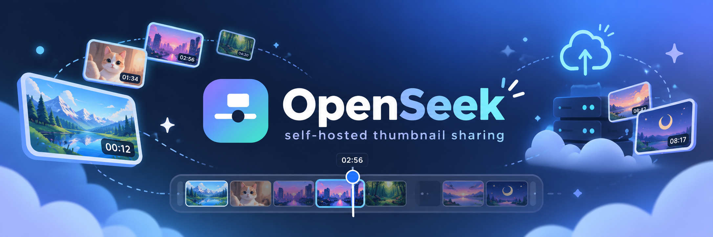
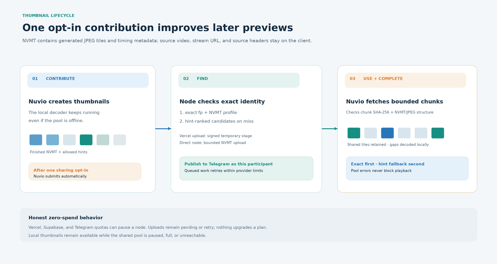

# OpenSeek

<p align="center"></p>

**OpenSeek helps Nuvio-compatible clients reuse preview thumbnails through a community-run pool.** Each client still makes thumbnails on its own device. When a user opts in, the finished thumbnails can be shared so another client can reuse them instead of decoding the same media again.

The pool is designed to have **no central OpenSeek API and no project-paid hosting**. Participants operate their own pool nodes and accounts. Telegram is the durable shared store; each node keeps its own index and upload state. To keep a node at zero spend, use the providers' free plans and disable any account-level automatic upgrade. Free tiers have limits, so a node may pause or queue work when it runs out of capacity. OpenSeek never silently upgrades a plan.

OpenSeek does not receive or store video files, playback URLs, or source headers. The shared format is NVMT: a bounded package of generated JPEG preview tiles and timing metadata.

## What a contribution contains

An opted-in contribution contains generated JPEG tiles, their timing and NVMT profile, the media fingerprint, and any available matching hints such as IMDb ID, season and episode, duration, file size, or normalized filename. Those hints let another release of the same title find an approximate package. OpenSeek never sends the source video, playback URL, or source request headers. Nuvio contribution is off until the user enables it, and can be disabled again in Settings.

## How the pool fits together


A Vercel node and a local/VPS node are peers, not separate roles. Either deployment can serve exact and hint lookups and publish accepted contributions. The main difference is where the rebuildable index lives (Supabase for Vercel, SQLite for local/VPS); Vercel also uses temporary staging for large uploads.

Nuvio generates thumbnails locally while playback continues. It can ask a pool node for an **exact match** using the media fingerprint and NVMT profile. If no exact package is available, it can try a **hint-ranked candidate** using allowed catalog and file hints. Hint matches are approximate and use a timing map.

The node checks stored tile digests before returning them. Nuvio checks each response's SHA-256, NVMT structure, tile slots, and JPEG markers before using shared thumbnails. Sparse or partial packages are useful: Nuvio keeps verified shared tiles and generates any missing frames locally. A bad package, an empty pool, or an offline node does not stop local thumbnail generation.

With sharing enabled, Nuvio submits its locally generated NVMT package to its configured node. That node validates it and publishes the tiles and hint manifest to Telegram. An upload is reported as accepted only after Telegram has accepted the publication.

## Who connects to the Telegram group?

The pool owner creates one private Telegram **supergroup**, allows members to read history and send messages and media, and shares an invite that lets people join directly. The owner does not add a bot for every participant or approve every join request.

Each participant connects their own OpenSeek node to the group with their own Telegram user account. The setup wizard signs that account in, joins through the invite, checks read and post access, and stores its session only in that participant's deployment. The node publishes as that participant. It does not need a bot token.

There are a few one-time setup actions: sign in to Vercel and Supabase, authorize Telegram with a login code and optional two-step password, accept the shared invite, and enter the one-time OpenSeek pairing bundle in Nuvio. After that, sharing is automatic when the user has enabled contribution in Nuvio. There is no manual Telegram upload or approval for each contribution.



## Supported pool modes

| Mode | Where it runs | Telegram connection | Index and upload state |
|---|---|---|---|
| Local-only | Nuvio with no shared pool | None | None |
| Host API | An existing local/VPS OpenSeek host | The host uses its configured Telegram Bot API identity; participants use scoped read/write keys | Host's local SQLite database |
| Direct Telegram | Each local/VPS OpenSeek node | The node's configured Telegram identity (usually its own user session; a bot must be added by a group admin) | Rebuildable SQLite index on each node |
| Participant Vercel | Each participant's Vercel deployment | Each node uses its own authorized Telegram user session | That participant's Supabase Postgres project; temporary upload staging in Supabase Storage |

The host API remains available for communities that choose a trusted host. Direct Telegram and participant Vercel modes avoid requiring one shared OpenSeek API. These modes use the same Nuvio pool protocol, so clients still try exact matches first, then hints, and generate locally for missing tiles.

## Participant-owned Vercel setup

The wizard runs on the participant's computer. It uses the official Vercel and Supabase CLIs for browser sign-in, creates or links the participant's own projects, applies the OpenSeek schema, configures a private staging bucket, deploys the node, and checks its health. Provider credentials are not written to the wizard's resume file.

### Requirements

- Python 3.12 or later and the OpenSeek backend dependencies.
- A Vercel account and the Vercel CLI.
- A Supabase account and the Supabase CLI.
- A Telegram account, an API ID and API hash from [my.telegram.org](https://my.telegram.org), and the current shared-group invite.
- A Nuvio build with OpenSeek pairing and contribution settings.

Install the Vercel and Supabase CLIs using their official guides: [Vercel CLI](https://vercel.com/docs/cli) and [Supabase CLI](https://supabase.com/docs/guides/cli). The OpenSeek wizard will prompt those tools to sign in through their normal browser flows.

### Run the wizard

```sh
git clone https://github.com/Yatin-Code/openseek-telegram.git
cd openseek-telegram/backend
python3 -m venv .venv
.venv/bin/pip install -r requirements.txt -c requirements-lock.txt
.venv/bin/python -m openseek setup
```

On Windows, use `.venv\Scripts\pip` and `.venv\Scripts\python` in place of the POSIX paths above. Choose **Join the shared pool on my own Vercel account**. The wizard guides you through:

1. Signing in to Vercel and linking or creating your OpenSeek project.
2. Linking or creating your Supabase project and applying the required schema and private storage bucket.
3. Deploying a setup-pending node and checking that it responds.
4. Signing in to Telegram, joining the shared invite, and checking group history and send permissions.
5. Deploying the Telegram-enabled node and checking it again.
6. Creating a one-time Nuvio pairing bundle. Enter it in **Nuvio → Settings → OpenSeek → Pair**, then enable contribution if you want to share.

The wizard can resume after an interruption. Its local progress file is `~/.config/openseek/participant-setup.json` with owner-only permissions. Telegram session and API hash values are sent to the participant's Vercel project and are not saved in that progress file. The generated dashboard secret is stored separately in `~/.config/openseek/participant-setup.admin-token` with owner-only permissions; setup prints a dashboard link that carries the secret only in the URL fragment. The Telegram account remains under the participant's control; revoke its session or disable contribution at any time.

The pool owner still performs the one-time group setup and shares the direct-join invite. For the group to work, new members must see its history and be allowed to send messages and media. An invite that requires owner approval is not suitable for the hands-off participant flow.

For the full wizard details and recovery steps, see [Participant-owned Vercel nodes](docs/VERCEL.md).

## Manage your node

The browser dashboard manages the OpenSeek node you own. On Vercel, open its deployment
URL with the owner secret in the URL fragment, for example
`https://your-node.vercel.app/#<OPENSEEK_ADMIN_TOKEN>`. The dashboard saves that secret
in the browser session and removes it from the address bar. On a local or VPS install,
open the dashboard URL shown by `python -m openseek dashboard`.

From the dashboard, you can check the Telegram connection and pool index, pair and revoke
Nuvio devices, enable or disable pool sharing and guest uploads, and create or revoke
invites. The owner secret protects these controls; Nuvio uses its separate device token
or pool keys. To publish a package from the dashboard, submit a media URL and start
**Generate and publish**. This is an explicit owner action with progress and status.
Playback and lookup requests never trigger media extraction; during playback Nuvio
generates its own thumbnails locally when it has no usable shared match.

## What the Vercel node stores


| Location | Data | Purpose |
|---|---|---|
| Telegram supergroup | Accepted NVMT tile documents and versioned hint manifests | Canonical durable pool; participants' nodes can rebuild their indexes from it |
| Supabase `pool_channel_tiles` | Tile slot, digest, duration, and Telegram message ID | Exact NVMT package index |
| Supabase `pool_hints` and `pool_episode_packages` | Validated catalog, episode, filename, duration, and ranking metadata | Hint-based candidate lookup |
| Supabase `pool_channel_state` | Last indexed Telegram message ID and scan time | Continue or rebuild channel indexing |
| Supabase `pool_uploads` and `pool_publication_queue` | Pending upload metadata, status, retry time, and error code | Durable publish lifecycle and recovery |
| Supabase `pool_devices`, `pool_invites`, and session lease | Pairing credentials, one-time invites, and concurrency lock | Manage Nuvio access and serialize use of the Telegram session |
| Private Supabase Storage bucket | Temporary staged NVMT upload object | Bypass Vercel's function request body limit; removed after publication or cleanup |

Supabase is not another permanent thumbnail store. Its tables are rebuildable or operational state; accepted thumbnail bytes remain in Telegram. A participant's Vercel deployment and Supabase project are independent of every other participant's deployment.

## Limits, failures, and recovery

| Situation | OpenSeek behavior |
|---|---|
| Large contribution on Vercel | Nuvio sends package bytes to a short-lived signed Supabase staging URL. Vercel receives only bounded metadata and status requests. |
| Large thumbnail read | The node returns at most 12 tiles per chunk, with a 4.5 MB response guard matching [Vercel's Function payload limit](https://vercel.com/docs/functions/limitations). NVMT packages are capped at 16 MiB and individual tiles at 256 KiB. |
| Partial package or missing Telegram tiles | Nuvio keeps valid shared tiles and locally fills the missing slots. |
| Invalid manifest, checksum, or JPEG tile | The response is rejected; local thumbnail generation continues. |
| Supabase outage or quota | The node returns a retryable or paused state. Quota pauses honor provider `Retry-After` when available; otherwise publication waits before retrying. No paid plan is enabled automatically. |
| Telegram FloodWait or group slow mode | The publication queue retains the contribution and schedules another attempt after Telegram's requested delay. |
| Expired or terminal upload | Temporary staged bytes are deleted immediately where possible; cleanup retries if Supabase is unavailable. |
| Empty, stale, or unavailable node index | A node refreshes or rebuilds its own index from Telegram. A newly posted item may take a refresh cycle to appear in a different node's index. |

Contribution status distinguishes work that is pending, retrying, paused, accepted, or failed. `accepted` means Telegram accepted the tiles and manifest. Vercel, Supabase, and Telegram set their own free-tier quotas and service availability; OpenSeek is best-effort and can pause or build a backlog to preserve the zero-spend rule.

For recovery and troubleshooting, see [docs/VERCEL.md](docs/VERCEL.md), [docs/TELEGRAM-POOL.md](docs/TELEGRAM-POOL.md), and [docs/INSTALL.md](docs/INSTALL.md).

## Local OpenSeek setup

The shared pool is optional. OpenSeek works in local-only mode, where Nuvio generates thumbnails on the device and no Telegram, Vercel, or Supabase setup is needed.

For a local/VPS service, see the [installation guide](docs/INSTALL.md). The shortest Linux source setup is:

```sh
cd backend
python3 -m venv .venv
.venv/bin/pip install -r requirements.txt -c requirements-lock.txt
.venv/bin/python -m openseek serve
```

To create a node that joins a Telegram community directly, run `.venv/bin/python -m openseek setup` and choose **Join a community pool**. To use a host API, choose **Host a public pool** or configure it as described in [docs/TELEGRAM-POOL.md](docs/TELEGRAM-POOL.md).

## Project boundaries

- OpenSeek moves generated preview thumbnails; it does not download or redistribute source video.
- Sharing is opt-in. Nuvio generates previews locally whether the pool is enabled or not.
- Exact fingerprints remain distinct from approximate catalog hints. Hints never replace the exact content key.
- The shared pool is experimental and has no uptime, latency, or unlimited-capacity guarantee.
- You are responsible for having rights or permission to generate and share thumbnails from the media you use. Read [Responsible use](docs/RESPONSIBLE-USE.md).

## Documentation

- [Architecture](docs/ARCHITECTURE.md)
- [Participant-owned Vercel setup](docs/VERCEL.md)
- [Telegram pool modes](docs/TELEGRAM-POOL.md)
- [Installation](docs/INSTALL.md)
- [HTTP API contract](docs/api/CONTRACT-v1.md)
- [Security model](docs/SECURITY-MODEL.md) and [vulnerability reporting](SECURITY.md)
- [Responsible use](docs/RESPONSIBLE-USE.md)
- [Contributing](CONTRIBUTING.md), [license](LICENSE), and [changelog](CHANGELOG.md)

OpenSeek is free software under the **GNU Affero General Public License v3 or later** (AGPL-3.0-or-later). See [LICENSE](LICENSE). The project does not publish prebuilt Docker images because the PyAV wheels bundle FFmpeg libraries built with GPL components; build from source with `docker compose up -d --build`. See [docs/LICENSE-OPTIONS.md](docs/LICENSE-OPTIONS.md).
