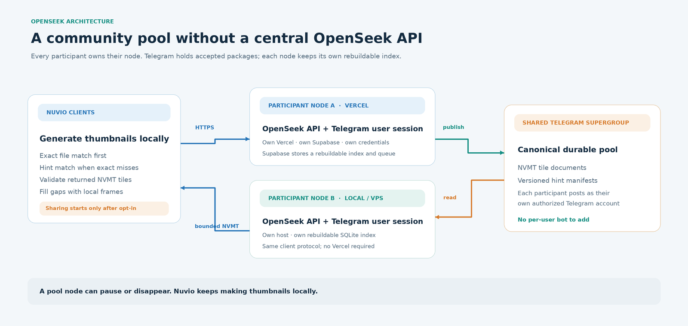
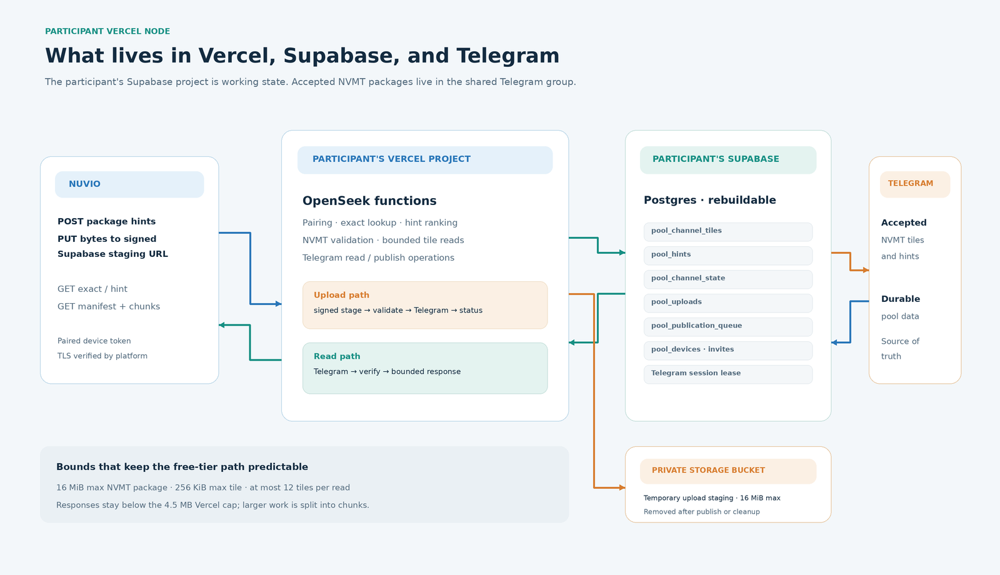

# OpenSeek-Telegram

**OpenSeek-Telegram lets Nuvio-compatible clients reuse preview thumbnails through a community-run pool.** Each TV still generates thumbnails locally. When a user opts in, the finished NVMT package can be shared so another client reuses it instead of decoding the same media again.

There is **no central OpenSeek API and no project-paid hosting**: each participant runs their own node on their own Vercel + Supabase account (or a local/VPS server), and Telegram is the durable shared store. Every node keeps a rebuildable index. Free tiers are enough for a small pool; a node may pause or queue work when a quota runs out, and OpenSeek never silently upgrades a plan.

OpenSeek-Telegram never receives or stores video files, playback URLs, or source headers. The shared format is **NVMT**: a bounded package of generated JPEG preview tiles and timing metadata.

---

## Pick your path

| You want to… | Mode | Telegram identity | Index / upload state | Start here |
|---|---|---|---|---|
| Use thumbnails only on this machine | **Local-only** | none | none | [Mode 1](#mode-1--local-only) |
| Share with a Telegram group from this server | **Local/VPS, channel mode** | bot **or** user session | SQLite | [Mode 2](#mode-2--localvps-channel-mode) |
| Run one pool API for other people | **Host API** | the host's bot | SQLite on the host | [Mode 3](#mode-3--host-api) |
| Each person hosts their own node | **Vercel participant** | each participant's user session | Supabase Postgres | [Mode 4](#mode-4--vercel-participant-node) |

> **Recommended:** the [setup wizard](https://github.com/Yatin-Code/openseek-telegram#recommended-the-setup-wizard-cli) — `python -m openseek setup`. It creates or links the Vercel and Supabase projects, applies the schema, makes the private staging bucket, deploys, signs in to Telegram, joins the invite, and prints the Nuvio pairing bundle. It is resumable.
>
> **No terminal?** Use the [manual Vercel + Supabase copy path](#manual-vercel--supabase-the-copy-path). Everything except the Telegram session can be done in provider dashboards; the session itself still needs one wizard run (or an existing StringSession).

---

## Recommended: the setup wizard (CLI)

### Requirements

- Python 3.12 or later with `venv` support (verify the version with `python3 --version`), and `git`.
- For a Vercel node: a Vercel account and a Supabase account, plus the Vercel and Supabase CLIs on `PATH` ([Vercel CLI](https://vercel.com/docs/cli), [Supabase CLI](https://supabase.com/docs/guides/cli)). The wizard uses their normal browser sign-in.
- Or, instead of the CLIs: a Vercel token and a Supabase personal access token (`sbp_...`) for `--provider rest`.
- For a pool: a Telegram account, an API ID and API hash from [my.telegram.org](https://my.telegram.org), and the shared-group invite.
- A Nuvio build with the OpenSeek settings screen.

### Install

```sh
git clone https://github.com/Yatin-Code/openseek-telegram.git
cd openseek-telegram/backend
python3 -m venv .venv
.venv/bin/pip install -r requirements.txt -c requirements-lock.txt
```

On Windows, use `.venv\Scripts\pip` and `.venv\Scripts\python` in place of the POSIX paths.

### Run

```sh
.venv/bin/python -m openseek setup
```

| Menu choice | What it does | Where the values go |
|---|---|---|
| **1) Host a public pool** | Host-API mode: bot token, channel ID, generated read/write keys | writes `openseek.env` (mode 0600) |
| **2) Join a community pool** | Local/VPS channel mode: Telegram user login, joins the invite, checks access | writes `openseek.env` |
| **3) Skip (local-only)** | No pool; Nuvio generates thumbnails locally | writes `openseek.env` |
| **4) Join the shared pool on my own Vercel account** | Participant Vercel node: Vercel + Supabase projects, schema, bucket, deploy, health, Telegram, pairing | writes the participant resume file and prints the Nuvio bundle |

For choice 4, the wizard:

1. signs in to Vercel and links or creates your project;
2. links or creates your Supabase project, applies `backend/openseek/supabase/schema.sql`, and creates the private `openseek-staging` bucket;
3. deploys a **setup-pending** node and checks `/v1/health`;
4. signs in to Telegram, joins the shared invite, and checks history + send/media permission;
5. redeploys with Telegram enabled and checks health again;
6. prints a one-time **pairing bundle** for Nuvio.

With both token variables set, the wizard selects the REST backend automatically:

```sh
export OPENSEEK_VERCEL_TOKEN=...
export OPENSEEK_SUPABASE_ACCESS_TOKEN=sbp_...
.venv/bin/python -m openseek setup --provider rest
```

`--provider cli` always forces the CLI flow. Tokens are held in memory, never written to the resume file.

### What it creates and where state lives

| Thing | Where |
|---|---|
| Resume state | `~/.config/openseek/participant-setup.json` (0600) |
| Owner dashboard secret | `~/.config/openseek/participant-setup.admin-token` (0600), also printed as a URL fragment |
| Telegram StringSession | sent directly to the Vercel project's encrypted env; **not** in the resume file |
| Supabase schema | applied by the wizard (or pasted manually in the copy path) |
| Staging bucket | `openseek-staging`, private, 16 MiB per object |

Rerun `python -m openseek setup` to resume an interrupted run. `--new-pairing` creates a replacement Nuvio invite.

### Verify

```sh
curl -fsS https://<your-node>.vercel.app/v1/health
python -m openseek doctor          # local/VPS
python -m openseek pool status     # local/VPS
```

Expected health: `{"service": "openseek", "api": 1, ...}`. While the node is still setup-pending only `GET /v1/health` is available and it answers `200` with `{"service": "openseek", "setup_pending": true, ...}` — continue the wizard (Telegram step). A `503` with `{"error": "setup_required", ...}` means required environment variables are missing — finish the wizard or copy-path steps and redeploy.

---

## Manual Vercel + Supabase (the copy path)

Use this when you prefer dashboards to the wizard. It creates the same resources by hand.

> One step still needs a terminal: the Telegram **user StringSession** (Vercel rejects bot tokens and session files). Run `.venv/bin/python -m openseek setup` once for the Telegram step, or bring an existing StringSession.

### 1. Import the repository into Vercel

[](https://vercel.com/new/clone?repository-url=https%3A%2F%2Fgithub.com%2FYatin-Code%2Fopenseek-telegram)

1. Click the button (or **Vercel → Add New → Project → Import Git Repository**). Vercel clones the repository into your Git account.
2. Keep the repository name you like.
3. Set **Root Directory = `backend`**.
4. If you already have the Supabase values, paste them in the import form; otherwise deploy now and redeploy in step 6 after adding the env vars.

### 2. Create the Supabase project

1. [supabase.com/dashboard](https://supabase.com/dashboard) → **New project**.
2. Pick an organization and the Free plan. **Do not enable any paid add-on.**
3. Choose a region near your users and set a database password.
4. Copy from **Project Settings → API**:
   - **Project URL** → `OPENSEEK_SUPABASE_URL`
   - **`service_role` key** → `OPENSEEK_SUPABASE_SERVICE_KEY` (never the anon key)

### 3. Apply the schema (copy-paste)

1. Supabase → **SQL Editor** (left sidebar) → **New query**.
2. Open [`backend/openseek/supabase/schema.sql`](backend/openseek/supabase/schema.sql) and copy the whole file.
3. Paste it into the editor and click **Run**.
4. You should see **“Success. No rows returned”**. The script is idempotent; running it twice is harmless.

### 4. Create the staging bucket

Supabase → **Storage** → **New bucket**:

- Name: `openseek-staging`
- **Private** (not public)
- File size limit: **16 MB**
- Allowed MIME types: leave empty or `application/vnd.openseek.nvmt`

This bucket only holds temporary upload bytes; Telegram remains the durable store.

### 5. Production environment variables

Vercel → your project → **Settings → Environment Variables → Production**:

```dotenv
OPENSEEK_PROFILE=vercel
OPENSEEK_POOL_MODE=channel
OPENSEEK_ADMIN_TOKEN=<at least 16 random characters>
OPENSEEK_SUPABASE_URL=https://<project>.supabase.co
OPENSEEK_SUPABASE_SERVICE_KEY=<service-role-key>
OPENSEEK_SUPABASE_BUCKET=openseek-staging
OPENSEEK_TELEGRAM_CHANNEL_ID=-1001234567890
OPENSEEK_TELEGRAM_API_ID=123456
OPENSEEK_TELEGRAM_API_HASH=<api-hash>
OPENSEEK_TELEGRAM_SESSION=<telethon-string-session>   # see step 7 if you do not have one
OPENSEEK_CONTRIBUTION=1
```

Optional: `CRON_SECRET`, `OPENSEEK_PUBLIC_TLS_PIN`. Do **not** set `OPENSEEK_SETUP_PENDING` or `OPENSEEK_SETUP_KEY` by hand — they are wizard-managed.

Generate the owner secret once and keep it:

```sh
python3 -c "import secrets; print(secrets.token_urlsafe(32))"
```

### 6. Deploy and verify

Vercel → **Deployments → Redeploy** (needed after env changes), then:

```sh
curl -fsS https://<your-node>.vercel.app/v1/health
```

With the Telegram session in place, a configured node returns `{"service": "openseek", "api": 1, ...}`. Until then the deployment serves the setup page (and `/v1/health` reports `setup_required`); that is expected.

### 7. Telegram session

Vercel rejects bot tokens and session files, so the node needs a Telethon **StringSession**:

- **If you already have one**, put it in `OPENSEEK_TELEGRAM_SESSION` (step 5) and redeploy.
- **Otherwise**, the supported way to create it is the wizard's Telegram stage:

  ```sh
  cd backend
  .venv/bin/python -m openseek setup --provider rest   # or omit for the CLI flow
  ```

  Choose **4**, and when prompted select your **existing** Vercel and Supabase projects. Complete the Telegram login and group join. The wizard writes the StringSession to the Vercel project (it never prints it), redeploys, and prints the Nuvio pairing bundle.

### 8. Dashboard, invite, Nuvio

- Open `https://<your-node>.vercel.app/#<OPENSEEK_ADMIN_TOKEN>` once. The dashboard stores the secret in the browser session and removes the fragment.
- Create a one-time **Nuvio invite** in the dashboard.
- On the TV: **Settings → OpenSeek**
  - **Server** = `https://<your-node>.vercel.app` (no path, no `#`)
  - **Link** = the 16-character invite code, or the whole `URL|code` bundle
  - **TLS pin** = leave empty for Vercel (public CA)
  - enable **Receive shared thumbnails**; enable **Contribute** only if you want to upload

### Troubleshooting (manual path)

| Symptom | Cause | Fix |
|---|---|---|
| Health `503 setup_required` | Telegram/owner vars missing | finish step 5–7 and redeploy |
| `unknown table pool_...` | schema not applied | step 3 |
| `staging_unavailable` / upload 500 | bucket missing or wrong key | step 4 and the service-role key |
| Nuvio `pairing_closed` | invite used/expired or sharing off | create a new invite, enable sharing |
| `not_contribute` | contribution off or invite without contribution | enable it and re-pair |
| Health 500 after deploy | a required env is invalid | Vercel → Functions → Logs |

---

## Mode 1 — Local only

No pool, no Telegram, no Supabase. Nuvio generates thumbnails on the device.

```sh
cd backend
python3 -m venv .venv
.venv/bin/pip install -r requirements.txt -c requirements-lock.txt
OPENSEEK_DATA_DIR="$HOME/.local/share/openseek" .venv/bin/python -m openseek serve
```

Open the dashboard URL printed at start-up. Keep the data directory outside the checkout; it holds the SQLite database, TLS key, admin token, and cache.

Useful environment: `OPENSEEK_DATA_DIR`, `OPENSEEK_PORT`, `OPENSEEK_ADMIN_PORT`. See [INSTALL.md](docs/INSTALL.md) for a service and Docker.

---

## Mode 2 — Local/VPS channel mode

One node joins the shared Telegram group directly and keeps its index in SQLite.

**Requirements:** a private Telegram supergroup, API ID/hash, and either a bot added by an admin or your own user session.

### CLI wizard (recommended)

```sh
.venv/bin/python -m openseek setup   # choice 2
```

It logs in with a Telegram user session, joins the invite, checks history + send/media access, and writes `openseek.env` (0600). Load it for the service, or point the service at it:

```sh
set -a; source ./openseek.env; set +a
# or: OPENSEEK_ENV_FILE=/path/to/openseek.env
```

### Dashboard first run (no terminal)

1. Start the server with no pool settings:
   ```sh
   OPENSEEK_DATA_DIR=/var/lib/openseek .venv/bin/python -m openseek serve
   ```
2. Open the dashboard URL printed at start-up.
3. Enter the channel ID, API ID/hash, and bot token or StringSession; the form saves them to `<data>/.env` (0600), verifies history + posting rights, and runs the first scan.
4. Enable **contribution** only if this node should publish.

### Verify

```sh
python -m openseek doctor
python -m openseek pool status
python -m openseek pool scan
```

For a VPS, keep the admin port on loopback and forward it over SSH:

```sh
ssh -L 8788:127.0.0.1:8788 operator@your-vps
```

---

## Mode 3 — Host API

One trusted host runs the pool API; participants use scoped keys. This is the only mode that needs a centrally reachable OpenSeek URL.

```sh
.venv/bin/python -m openseek setup   # choice 1
```

It writes `openseek.env` with:

```dotenv
OPENSEEK_POOL_MODE=host
OPENSEEK_POOL_ENABLED=1
OPENSEEK_TELEGRAM_BOT_TOKEN=<bot-token>
OPENSEEK_TELEGRAM_CHANNEL_ID=-1001234567890
OPENSEEK_POOL_READ_KEY=<24+ chars>
OPENSEEK_POOL_WRITE_KEY=<24+ chars>
```

Participants set on their own nodes:

```dotenv
OPENSEEK_POOL_MODE=host
OPENSEEK_POOL_URL=https://pool.example.org
OPENSEEK_POOL_READ_KEY=<the read key>
# only if they may contribute:
OPENSEEK_POOL_WRITE_KEY=<the write key>
OPENSEEK_POOL_SHARE=1
```

The host needs a trusted HTTPS endpoint. Bot-token limits and the 20-messages-per-minute group guidance apply to bots. Keep read and write keys separate and rotate them when a participant leaves.

---

## Mode 4 — Vercel participant node

Each participant owns a Vercel project and a Supabase project; both are peers of any local/VPS node.

- **Wizard:** [Recommended: the setup wizard](#recommended-the-setup-wizard-cli), choice 4.
- **Manual:** [Manual Vercel + Supabase](#manual-vercel--supabase-the-copy-path).
- **What is stored where:** [What the Vercel node stores](#what-the-vercel-node-stores).

A Vercel node requires a **user StringSession**; it rejects bot tokens and session files because function instances are disposable. Use the wizard once to create it.

---

## Telegram group setup (all pool modes)

The pool owner does this once:

1. Create a private **supergroup** (not a broadcast channel).
2. Allow members to **read history** and **send messages and media**.
3. Make an invite that joins **directly** (no owner approval).
4. Share the invite and the channel ID.

Each contributor needs one identity:

- **User session** (recommended for participants): the account joins the invite and publishes as itself. It needs history read plus Send Messages/Send Media.
- **Bot:** create it with BotFather; a group admin adds it and grants posting. A bot cannot read channel history, so a bot identity can publish contributions and run the librarian, but it cannot serve reads or rebuild an index. A bot cannot join an invite by itself, and a Vercel node cannot use a bot token.

Keep the group private. Do not post tokens or sessions in the group.

---

## Nuvio settings

On the TV: **Settings → OpenSeek**

| Field | What to enter |
|---|---|
| **Servidor OpenSeek** | `https://<your-node>.vercel.app` — HTTPS origin, no path, no fragment |
| **Pin TLS do OpenSeek** | empty for Vercel (public CA); only for a self-signed local/VPS server |
| **Vincular OpenSeek** | the one-time `URL|CODE` bundle, or just the 16-character code when the URL is already set |
| **Receber miniaturas compartilhadas** | ON to read from the pool |
| **Contribuir miniaturas** | ON to upload (invite must allow contribution) |
| **Ver erros do OpenSeek** | live log for pairing/candidate/contribution failures |

Tapping **Vincular** again while linked revokes the pairing.

---

## Environment variables

The wizard writes most of these. Use the table when configuring by hand.

- **Local/VPS:** keep the values in the file named by `OPENSEEK_ENV_FILE`, or `<OPENSEEK_DATA_DIR>/.env`; mode `0600`. Set `OPENSEEK_DATA_DIR` and `OPENSEEK_ENV_FILE` in the service environment, not in the file.
- **Vercel:** **Project → Settings → Environment Variables → Production**, then redeploy.
- **Secrets:** angle brackets are placeholders. Never commit the file or paste values into issues.

| Variable | Local/VPS | Vercel | Notes |
|---|---|---|---|
| `OPENSEEK_PROFILE` | `local` (default) | `vercel` (required) | `VERCEL=1` also selects the Vercel profile. |
| `OPENSEEK_DATA_DIR` | service environment; default `data` | not set; `/tmp` scratch only | Holds SQLite, TLS key, admin token, cache. |
| `OPENSEEK_ENV_FILE` | service environment; optional | not used | Path to the `.env` file. |
| `OPENSEEK_POOL_MODE` | `channel` or `host`; omit for local-only | `channel` (required) | |
| `OPENSEEK_ADMIN_TOKEN` | optional | required, 16+ chars | Owner dashboard secret. |
| `OPENSEEK_TELEGRAM_CHANNEL_ID` | required for `channel` | required | `-100...` |
| `OPENSEEK_TELEGRAM_API_ID` | required for `channel` | required | from my.telegram.org |
| `OPENSEEK_TELEGRAM_API_HASH` | required for `channel` | required | keep secret |
| `OPENSEEK_TELEGRAM_BOT_TOKEN` | one identity option | rejected | Vercel needs a user session. |
| `OPENSEEK_TELEGRAM_SESSION_FILE` | one identity option | not usable | local user session file |
| `OPENSEEK_TELEGRAM_SESSION` | one identity option | required | Telethon StringSession |
| `OPENSEEK_CONTRIBUTION` | `0` default | set `1` to publish | server-side publishing switch |
| `OPENSEEK_POOL_CHANNEL_WRITABLE` | `auto` | `auto` | `1`/`0` overrides detection |
| `OPENSEEK_SUPABASE_URL` | not used | required | `https://<project>.supabase.co` |
| `OPENSEEK_SUPABASE_SERVICE_KEY` | not used | required | service-role key, never anon |
| `OPENSEEK_SUPABASE_BUCKET` | not used | `openseek-staging` | private staging |
| `OPENSEEK_POOL_WRITE_KEY` | host / relay | optional | 24+ chars |
| `OPENSEEK_POOL_CONTRIB_URL` | read-only node | not needed | HTTPS intake for read-only nodes |
| `OPENSEEK_LIBRARIAN` | optional relay | optional | bot username or HTTPS URL |
| `OPENSEEK_LIBRARIAN_KEY` | with librarian | optional | 24+ chars |
| `OPENSEEK_LIBRARIAN_ENABLED` | relay host | not usable | needs a bot token |
| `OPENSEEK_PUBLIC_TLS_PIN` | optional | optional | `sha256//...` |
| `CRON_SECRET` | not needed | optional | `/v1/internal/tick` |
| `OPENSEEK_CRON_SECRET` | optional | optional | prefixed equivalent for `.env` |
| `OPENSEEK_POOL_URL` | host mode | ignored | upstream pool origin |
| `OPENSEEK_POOL_READ_KEY` | host mode | ignored | 24+ chars |
| `OPENSEEK_POOL_SHARE` | host mode | ignored | accept shared contributions |
| `OPENSEEK_POOL_ENABLED` | legacy host switch | ignored | prefer `OPENSEEK_POOL_MODE=host` |

Use exactly one Telegram identity. Local-only needs only `OPENSEEK_PROFILE=local`; leave `OPENSEEK_POOL_MODE` unset.

Runtime tuning (ports, cache, workers, preview tolerance, public listener, TLS files, logging) is documented with defaults in `backend/openseek/config.py`.

### Minimal local/VPS pool

Service environment:

```sh
OPENSEEK_DATA_DIR=/var/lib/openseek
OPENSEEK_ENV_FILE=/var/lib/openseek/.env
```

`/var/lib/openseek/.env` (mode `0600`):

```dotenv
OPENSEEK_PROFILE=local
OPENSEEK_POOL_MODE=channel
OPENSEEK_TELEGRAM_CHANNEL_ID=-1001234567890
OPENSEEK_TELEGRAM_API_ID=123456
OPENSEEK_TELEGRAM_API_HASH=<api-hash>
OPENSEEK_TELEGRAM_BOT_TOKEN=<bot-token>
# Or replace the bot token with a user session:
# OPENSEEK_TELEGRAM_SESSION_FILE=/var/lib/openseek/telegram/openseek.session
OPENSEEK_POOL_CHANNEL_WRITABLE=auto
OPENSEEK_CONTRIBUTION=1
# Optional; otherwise generated in <OPENSEEK_DATA_DIR>/admin.token
# OPENSEEK_ADMIN_TOKEN=<at-least-16-characters>
```

### Minimal Vercel node

Production environment variables:

```dotenv
OPENSEEK_PROFILE=vercel
OPENSEEK_POOL_MODE=channel
OPENSEEK_ADMIN_TOKEN=<at-least-16-characters>
OPENSEEK_TELEGRAM_CHANNEL_ID=-1001234567890
OPENSEEK_TELEGRAM_API_ID=123456
OPENSEEK_TELEGRAM_API_HASH=<api-hash>
OPENSEEK_TELEGRAM_SESSION=<telethon-string-session>
OPENSEEK_SUPABASE_URL=https://<project>.supabase.co
OPENSEEK_SUPABASE_SERVICE_KEY=<service-role-key>
OPENSEEK_SUPABASE_BUCKET=openseek-staging
OPENSEEK_CONTRIBUTION=1
# Optional:
# CRON_SECRET=<cron-secret>
# OPENSEEK_PUBLIC_TLS_PIN=sha256//<spki-pin>
```

The Vercel setup wizard creates the Telegram session, Supabase schema, bucket, and environment variables for you. Its temporary `OPENSEEK_SETUP_PENDING` and `OPENSEEK_SETUP_KEY` values are wizard-managed; do not set them by hand.


---

## How the pool fits together



A Vercel node and a local/VPS node are peers, not separate roles. Either can serve exact and hint lookups and publish accepted contributions. The difference is where the rebuildable index lives (Supabase for Vercel, SQLite for local/VPS), and Vercel's temporary upload staging.

Nuvio generates thumbnails locally while playback continues. It asks the node for an **exact match** by fingerprint + NVMT profile. On a miss it can try a **hint-ranked candidate** (IMDb, season/episode, duration, size, filename). Hint matches are approximate and use a timing map.

The node checks stored tile digests. Nuvio checks the response's SHA-256, NVMT structure, slots and JPEG markers. Sparse packages are fine: verified shared tiles are kept and missing frames are generated locally. A bad package, empty pool or offline node never stops local thumbnails.

With sharing enabled, Nuvio submits its package to its node; the node validates it and publishes tiles + hint manifest to Telegram. An upload is reported accepted only after Telegram accepted the publication.

### What a contribution contains

Generated JPEG tiles, their timing and NVMT profile, the media fingerprint, and allowed hints (IMDb, season/episode, duration, file size, normalized filename). No video bytes, no playback URL, no source headers. Contribution is off until the user enables it in Nuvio.

---

## Manage your node

The browser dashboard is the owner interface.

- **Vercel:** `https://<node>/#<OPENSEEK_ADMIN_TOKEN>`
- **Local/VPS:** the URL printed by `python -m openseek dashboard`

It shows the Telegram connection and pool index, pairs/revokes Nuvio devices, enables/disables sharing and guest uploads, creates/revokes invites, and starts an explicit **Generate and publish** task. Playback and lookup requests never trigger media extraction.

---

## What the Vercel node stores



| Location | Data | Purpose |
|---|---|---|
| Telegram supergroup | NVMT tile documents + hint manifests | canonical durable pool; rebuildable by any node |
| Supabase `pool_channel_tiles` | slot, digest, duration, Telegram message ID | exact package index |
| Supabase `pool_hints`, `pool_episode_packages` | catalog, episode, filename, duration, ranking | hint lookup |
| Supabase `pool_channel_state` | last indexed message ID, scan time | resume/rebuild indexing |
| Supabase `pool_uploads`, `pool_publication_queue` | status, retry time, error | publish lifecycle |
| Supabase `pool_devices`, `pool_invites`, session lease | pairing, one-time invites, concurrency lock | access control |
| Private Storage bucket | temporary staged NVMT object | bypass the function body limit; deleted after publication |

Supabase is not a second permanent thumbnail store. Its tables are rebuildable or operational state; accepted bytes remain in Telegram.

---

## Limits, failures, recovery

| Situation | OpenSeek behavior |
|---|---|
| Large contribution on Vercel | signed Supabase staging URL; only bounded metadata goes through the function |
| Large thumbnail read | ≤12 tiles per chunk, 4.5 MB response guard; packages ≤16 MiB, tiles ≤256 KiB |
| Partial package / missing tile | keep valid shared tiles, generate the rest locally |
| Bad manifest/checksum/JPEG | reject the response; local generation continues |
| Supabase outage/quota | retryable/paused state with backoff; no paid plan is enabled |
| Telegram FloodWait / slow mode | queue retains the contribution and retries after the requested delay |
| Expired upload | staged bytes deleted; cleanup retries |
| Empty/stale index | node refreshes or rebuilds from Telegram |

`accepted` means Telegram accepted the tiles and manifest. Everything is best-effort; free-tier quotas can pause a node.

---

## Troubleshooting

```sh
python -m openseek doctor              # local/VPS health summary
python -m openseek pool status         # index progress
python -m openseek pool scan           # scan now
python -m openseek pool rebuild        # rebuild the local index
curl -fsS https://<node>/v1/health
```

- `503 setup_required` → the node is live but Telegram/owner settings are missing.
- `unknown table` → the Supabase schema was not applied.
- `pairing_closed` → the invite expired/was used, or sharing is off.
- `not_contribute` → contribution is disabled or the invite did not grant it.
- Vercel 413 → the package exceeded the function response limit; use the chunked path.

More: [docs/VERCEL.md](docs/VERCEL.md), [docs/INSTALL.md](docs/INSTALL.md), [docs/TELEGRAM-POOL.md](docs/TELEGRAM-POOL.md).

---

## Project boundaries

- Moves generated preview thumbnails; never downloads or redistributes source video.
- Sharing is opt-in; Nuvio generates previews regardless of the pool.
- Exact fingerprints remain separate from approximate hints.
- The shared pool is experimental; no uptime, latency or unlimited-capacity guarantee.
- You are responsible for having rights to generate and share thumbnails from your media. See [Responsible use](docs/RESPONSIBLE-USE.md).

## Documentation

- [Architecture](docs/ARCHITECTURE.md)
- [Participant-owned Vercel nodes](docs/VERCEL.md)
- [Telegram pool](docs/TELEGRAM-POOL.md)
- [Installation](docs/INSTALL.md)
- [HTTP API contract](docs/api/CONTRACT-v1.md) and [hints v2](docs/api/HINTS-v2.md)
- [Security model](docs/SECURITY-MODEL.md) and [vulnerability reporting](SECURITY.md)
- [Responsible use](docs/RESPONSIBLE-USE.md)
- [Contributing](CONTRIBUTING.md), [license](LICENSE), [changelog](CHANGELOG.md)

OpenSeek is free software under the **AGPL-3.0-or-later**. Prebuilt Docker images are not published because the PyAV wheels bundle GPL FFmpeg libraries; build with `docker compose up -d --build`. See [docs/LICENSE-OPTIONS.md](docs/LICENSE-OPTIONS.md).
